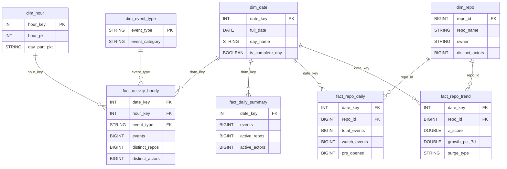

# Gold Layer Data Dictionary

Star schema in `workspace.gharchive`. Built by `notebooks/04_silver_to_gold.ipynb` (third task of the job `gharchive_pipeline`), full refresh on every run.
Keys are documented here and in the column comments. Delta does not enforce keys; `notebooks/05_gold_checks.ipynb` checks them (duplicate keys and orphan foreign keys must be 0).

## ER diagram

## Grain and keys

| Table | Type | Grain (one row per) | Primary key | Foreign keys | Clustering |
|---|---|---|---|---|---|
| dim_date | Dimension | calendar day in the loaded window | date_key | | |
| dim_hour | Dimension | hour of day (UTC) | hour_key | | |
| dim_event_type | Dimension | GitHub event type | event_type | | |
| dim_repo | Dimension | tracked repository | repo_id | | repo_id |
| fact_activity_hourly | Fact | day x hour x event type, all repositories | date_key, hour_key, event_type | dim_date, dim_hour, dim_event_type | date_key |
| fact_daily_summary | Fact | day | date_key | dim_date | |
| fact_repo_daily | Fact | tracked repository x active day | date_key, repo_id | dim_date, dim_repo | date_key, repo_id |
| fact_repo_trend | Fact | tracked repository x active day | date_key, repo_id | dim_date, dim_repo | date_key, repo_id |

**Tracked repository:** at least 3 different contributors, or at least 3 community events (stars, forks, pull requests, reviews, issues, comments, releases) in the loaded window. Rule and numbers live in `notebooks/common_gold.ipynb`.

## Columns

### dim_date
| Column | Type | Description |
|---|---|---|
| date_key | INT | PK, yyyymmdd |
| full_date | DATE | |
| year | INT | |
| month_num | INT | |
| month_name | STRING | |
| day_of_month | INT | |
| day_of_week_num | INT | 1 = Sunday ... 7 = Saturday |
| day_name | STRING | |
| week_of_year | INT | |
| is_weekend | BOOLEAN | |
| hours_loaded | INT | hourly GH Archive files loaded for this day (0 to 24) |
| is_complete_day | BOOLEAN | at least 22 of 24 hours loaded |
| load_timestamp | TIMESTAMP | |

### dim_hour
| Column | Type | Description |
|---|---|---|
| hour_key | INT | PK, hour of day in UTC (0 to 23) |
| hour_label | STRING | e.g. 09:00 UTC |
| hour_pkt | INT | same hour in Pakistan time (UTC+5) |
| day_part_pkt | STRING | Night, Morning, Afternoon, Evening (Pakistan time) |
| load_timestamp | TIMESTAMP | |

### dim_event_type
| Column | Type | Description |
|---|---|---|
| event_type | STRING | PK |
| event_category | STRING | Code, Pull requests, Issues, Popularity, Releases, Repository structure, Other |
| load_timestamp | TIMESTAMP | |

### dim_repo
| Column | Type | Description |
|---|---|---|
| repo_id | BIGINT | PK |
| repo_name | STRING | owner/name, latest name seen |
| owner | STRING | |
| repo_short_name | STRING | |
| first_seen_date | DATE | |
| last_seen_date | DATE | |
| total_events | BIGINT | events in the loaded window |
| distinct_actors | BIGINT | different contributors in the loaded window |
| community_events | BIGINT | stars, forks, PRs, reviews, issues, comments, releases |
| load_timestamp | TIMESTAMP | |

### fact_activity_hourly
| Column | Type | Description |
|---|---|---|
| date_key | INT | FK dim_date |
| hour_key | INT | FK dim_hour |
| event_type | STRING | FK dim_event_type |
| events | BIGINT | additive |
| distinct_repos | BIGINT | not additive across hours |
| distinct_actors | BIGINT | not additive across hours |
| load_timestamp | TIMESTAMP | |

### fact_daily_summary
| Column | Type | Description |
|---|---|---|
| date_key | INT | PK, FK dim_date |
| events | BIGINT | |
| active_repos | BIGINT | all repositories active that day |
| active_actors | BIGINT | different contributors that day |
| active_tracked_repos | BIGINT | tracked repositories active that day |
| load_timestamp | TIMESTAMP | |

### fact_repo_daily
| Column | Type | Description |
|---|---|---|
| date_key | INT | FK dim_date |
| repo_id | BIGINT | FK dim_repo |
| total_events | BIGINT | |
| push_events, pull_request_events, pr_review_events, issue_events, issue_comment_events, release_events, watch_events, fork_events, create_events, delete_events | BIGINT | events by type (watch = star) |
| distinct_actors | BIGINT | |
| prs_opened, prs_closed, prs_merged | BIGINT | from silver_pull_request.action (opened, closed, merged) |
| issues_opened, issues_closed | BIGINT | from silver_issue.action |
| load_timestamp | TIMESTAMP | |

### fact_repo_trend
| Column | Type | Description |
|---|---|---|
| date_key | INT | FK dim_date |
| repo_id | BIGINT | FK dim_repo |
| events | BIGINT | community events that day (PRs, reviews, issues, comments, stars, forks, releases); push, create and delete excluded because of source gaps |
| has_full_baseline | BOOLEAN | the 7 previous days are all complete days |
| baseline_avg | DOUBLE | average per day over the previous 7 calendar days (quiet days = 0) |
| baseline_std | DOUBLE | sample standard deviation over the same 7 days |
| z_score | DOUBLE | (events - baseline_avg) / baseline_std; only when baseline_avg is at least 1 event per day |
| pct_vs_baseline | DOUBLE | percent above or below the baseline |
| events_last_7d | BIGINT | this day and the 6 days before |
| events_prev_7d | BIGINT | the 7 days before that |
| growth_pct_7d | DOUBLE | momentum in percent; only when this day and the 13 days before are complete |
| is_surge | BOOLEAN | surge_type is not NULL |
| surge_type | STRING | Spike: baseline at least 1/day, at least 20 events, z_score at least 3. Breakout: baseline below 1/day and at least 50 events. NULL otherwise |
| load_timestamp | TIMESTAMP | |

## Operational table added in Phase 3

**gold_aggregation_metrics**: run_id, target_table, date_from, date_to, source_rows_read (Silver rows aggregated), rows_written, start_time, end_time, duration_seconds, load_timestamp. Gold also writes to `pipeline_execution_logs` with layer `Silver-to-Gold`.
